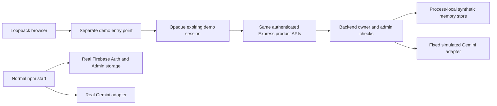
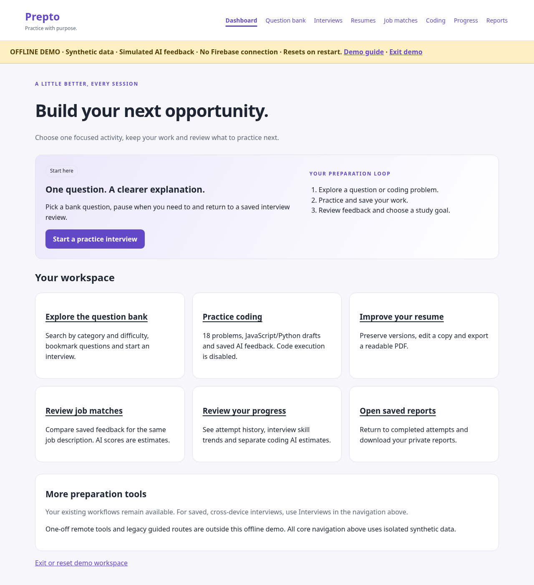
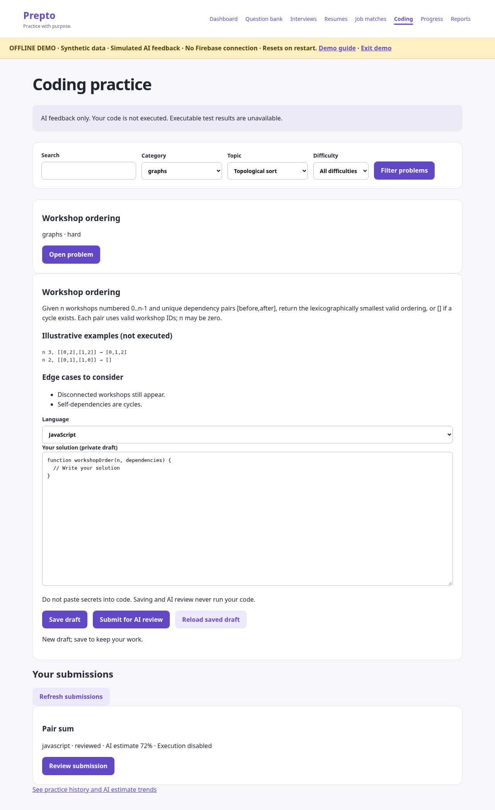
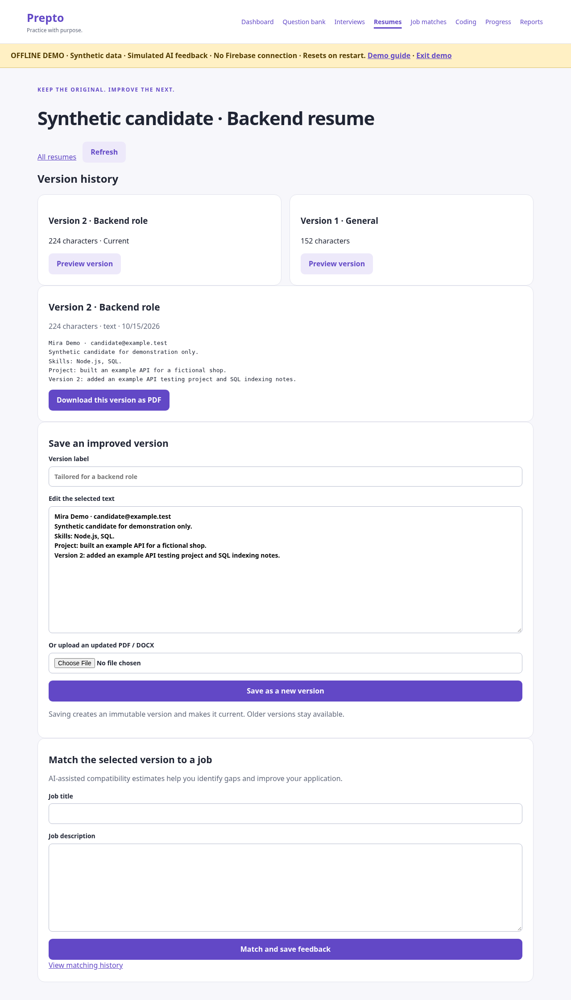
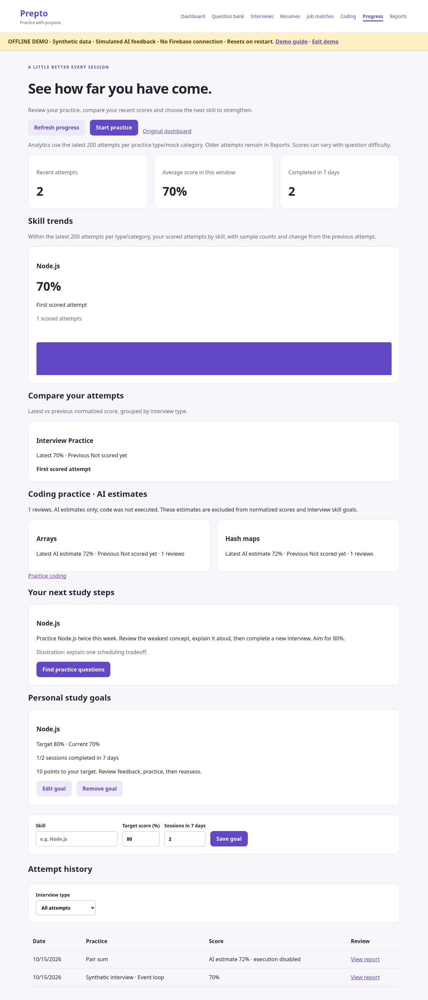
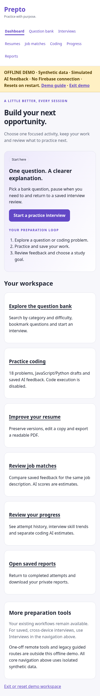

# Prepto offline product demo

This demo uses synthetic data and fixed simulated feedback. It is not live API, model-quality, production scalability or deployment validation. Untrusted code execution is disabled everywhere.

## Start

Use Node 24.19.0 (pinned in `.nvmrc`), npm and installed Chromium. From the repository root:

```sh
npm ci
npm run build
NODE_ENV=development HOST=127.0.0.1 PORT=8080 npm run demo
```

In your own local browser, open the loopback server on port 8080 at path `/demo`. For a remote terminal, use a trusted SSH tunnel to that loopback port; do not publish or bind the demo to a public address. The cloud onboarding interface is not a localhost preview. No environment Publish action, API key, Firebase project, saved secret or global proxy change is required. `npm ci` needs registry access for initial installation; the running demo requires no external network.

The command starts `scripts/demo-server.js`, **not** the production server. It never loads `.env`; existing secure bindings are neither changed nor used. `NODE_ENV=production` and public bind addresses are rejected. Production `npm start` has no demo switch; setting `DEMO_MODE` does not enable demo routes or authentication.

PDF export uses your installed Chromium and blocks network/file requests. If this isolated development container cannot support the Chromium sandbox, explicitly opt in only for this local process:

```sh
NODE_ENV=development HOST=127.0.0.1 PORT=8080 CHROMIUM_NO_SANDBOX=true npm run demo
```

Use the normal sandbox on systems that support it. `CHROMIUM_EXECUTABLE_PATH` can point to a nonstandard local installation. Text/PDF/DOCX features preserve the existing limits; regenerated PDFs do not preserve uploaded layouts.

## Five-minute walkthrough

1. `/demo`: read the OFFLINE DEMO notice, then **Start a private demo workspace**. This creates an anonymous synthetic learner with an opaque HttpOnly/SameSite=Strict `prepto_demo_token` cookie (separate from production `session_token` and its session cookie). No password, Firebase login or admin rights are involved.
2. Dashboard: follow the preparation loop. Shared navigation includes Question bank, Interviews, Resumes, Job matches, Coding, Progress and Reports. Tab to **Skip to main content**, press Enter and continue using keyboard controls. On mobile, the same links wrap and remain visible.
3. Question bank: search `node`, filter difficulty/category, and inspect the saved question using **Bookmarks**. Start a question in Interviews. A completed synthetic event-loop interview is already available. You can start another, pause/resume, answer and complete it; free-text feedback is fixed simulation. Multiple-choice grading is local deterministic answer comparison, not model feedback or code execution.
4. Coding: browse 18 authored problems or combine Category `graphs`, Topic `Topological sort`, Difficulty `hard` to open **Workshop ordering**. Inspect examples/edge cases and switch between JavaScript/Python starters. For **Pair sum**, a synthetic saved draft and review already exist. Save an edit, reload and submit for simulated AI feedback. The review explicitly states **no executable tests were run**. Its 72% value is an illustrative estimate, not a code-quality assessment. Open reference guidance after review.
5. Resumes: open **Synthetic candidate · Backend resume**. Compare two immutable versions, preview the older one and optionally export PDF. Add a third version to demonstrate preservation. Use fictional content only.
6. Job matches: two versions have saved records for the same fictional job. Select both completed records and compare them. Both have the same fixed illustrative score (76%); a zero delta is expected. Open a record to see its exact synthetic job text, model marker and recommendations. New matching requests use the same fixed demo response.
7. Progress: inspect completed interview history, Node.js goal and separate coding AI estimate trends. Coding estimates do not enter normalized interview averages or interview skill goals. Reports retains private view/JSON download actions.
8. Demo guide → **Exit and clear this workspace**: removes the current learner's records and revokes its demo token. Return with another browser profile to see a separate learner; private IDs from the first learner return 404. Starting again replaces that browser's old workspace. Restarting the process clears every demo record. Tokens expire after one hour; expired data is pruned on verification or the next start. At most 20 active local demo learners are allowed.

Legacy guided workflows and one-off remote tools remain in the normal product, but are intentionally unavailable in the offline demo. Normal account routes redirect to the demo guide; token exchange/profile endpoints are absent. The demo is a local exploration tool, not a public hosted sandbox or multi-tenant persistence service.

## Architecture and trust boundary



There is no path from demo data/adapters to real Firebase/Gemini. `createDemoApp` passes explicit offline dependencies and a fresh random session secret into `createApp`; it does not alter production auth middleware or read live credential values. Demo auth/session cookies use distinct names and do not overwrite a normal product login. Demo cookies are not Firebase tokens and production rejects them. Every demo learner is non-admin; server-side ownership checks, revision checks and transactional evaluation leases stay active. Firestore Admin bypasses rules in production, so those backend checks must remain enforced.

The shared in-memory adapter is also used by offline test doubles. It implements the Firestore operations used by product services, including staged serialized transactions; it is not a replacement for the actual emulator tests. Synthetic seeds go through the same resume, interview, coding and reporting services. Code is kept as text, with execution results unavailable. A Content Security Policy restricts demo browser connections/assets to self; live account, token/profile exchange and legacy remote routes are excluded. Host and peer loopback checks prevent public/rebinding use. No demo feature is enabled by production environment flags.

## Screenshots

The images below document the pre-React demo. Current actual React captures and migration notes are in [FRONTEND_MIGRATION.md](FRONTEND_MIGRATION.md); all signed-in data is synthetic, not live user data.







Regenerate from a clean synthetic workspace (the script starts/stops its own loopback server and browser):

```sh
npm run demo:screenshots
# Only for an isolated container without Chromium sandbox support:
CHROMIUM_NO_SANDBOX=true npm run demo:screenshots
```

## Exact validation commands

```sh
npm ci
npm run check
npm run test:browser
npm run test:emulator
npm audit --omit=dev --audit-level=high
```

`check` builds JavaScript/EJS, lints and runs all Jest suites with coverage, including real Chromium/PDF checks. `test:browser` reruns the focused browser suite, including the isolated demo journey; it is intentionally redundant when checking that journey separately. Backend tests reject all network fetches and production Firebase calls in the demo, verify cross-user boundaries, admin denial, failed-seed cleanup, expired sessions and production token rejection. Browser tests intercept requests and assert no external requests while completing the demo journey. They exercise real UI and APIs, not a fake success page.

`test:emulator` requires Java 21. It runs the real loopback Firestore emulator using `demo-prepto`, with mock Auth/Gemini and stripped credential variables. The first run downloads a checksum-verified emulator; subsequent runs can use its cache. Emulator tests validate rules, backend ownership, transactions and query behavior independently of the demo memory store. They do not establish deployed composite-index readiness.

CI runs npm ci, check, real emulator tests and the production audit gate. All tests keep injected bindings out of provider operations. See [DEPENDENCIES.md](DEPENDENCIES.md) for the existing three high dev-tooling findings awaiting an upstream supported fix; this milestone does not change dependencies.

## Pending checks and limits

- Real Firebase credentials, authenticated browser login/token refresh and real Gemini responses/quality: **pending**.
- Deployment, Firestore rules/index deployment/build readiness and production query behavior: **pending**.
- Public hosting, restore/backup drills, load testing and a full assistive-technology audit: **not validated** by this local milestone.
- Untrusted execution/isolated runner integration: **not implemented; execution disabled**. AI or simulated feedback never means executable test cases passed.
- Demo storage is volatile, bounded to local sessions and uses no durable backups; upload only synthetic content. Exit/restart, not a production deletion job, clears demo data.

See [OPERATIONS.md](OPERATIONS.md) for deployment commands, [API.md](API.md) for authenticated API behavior and [CODING_LIBRARY.md](CODING_LIBRARY.md) for the content review.

The default demo now uses the same React production build as the product. `npm run demo:dev` provides the same loopback isolation with Vite middleware. The legacy screenshot helper intentionally uses the compatibility renderer to retain historical visual references.
